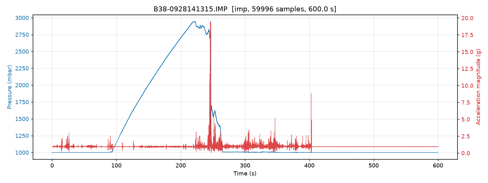

# RAPID & BDS Sensor Tools

**Open code, documentation and example data for fish-passage sensor
post-processing** — the Robust Autonomous Pressure and Inertial Device
(RAPID), the EU H2020 FITHydro Barotrauma Detection System (BDS), and the
RETERO fish backpacks.


The sensors write compact binary files. This repository turns them into
plain CSV tables and diagnostic plots with one command:



*A real turbine passage from `data/`: descent to ~3 bar, the strike
(~20 g) at the pressure drop, and the return to the surface.*

## Installation

Python 3.9+ is required.

```bash
git clone https://github.com/jtuhtan/RAPID.git
cd RAPID
pip install -e .
```

## Sixty-second tour

```bash
# convert one file (the sensor type is detected automatically)
rapid-convert data/RAPID/RAPID_V3/RAPID_V3_IMP/Turbine/B38-0928141315.IMP --plot

# convert a whole folder of measurements, recursively
rapid-convert data/ -r

# just inspect a file without writing anything
rapid-convert data/BDS/100_Hz/C130909084837.txt --info
```

Every file becomes `CSV/<name>-<format>.csv` next to it (self-describing
column headers with units) and, with `--plot`, a `PLOTS/<name>-<format>.png`
overview. From Python:

```python
import rapid_sensors

rec = rapid_sensors.read("B38-0928141315.IMP")   # format auto-detected
rec.data                                          # pandas DataFrame
```

See the **[User Guide](docs/user_guide.md)** for a full walkthrough and the
**[File Format Reference](docs/file_formats.md)** for the byte-level packet
layouts of every sensor.

## Supported sensors

| Format | File | Contents | Rate |
|---|---|---|---|
| `rapid_v1` | `.txt` | RAPID V1 / EDF strike sensor: acceleration + pressure | 2048 Hz |
| `hig` | `.HIG` | RAPID V3 high-g accelerometer (±400 g) | 2000 Hz |
| `imp` | `.IMP` | RAPID V3 IMU (acc, gyro, mag) + pressure, temperature, battery | 100 Hz |
| `bds100` | `.txt` | BDS: 3× pressure + BNO055 IMU with orientation (Euler, quaternion) | ~100 Hz |
| `bds250` | `.txt` | BDS: 3× pressure + raw IMU | ~100–250 Hz |

## Why the new readers

The original import scripts (kept in [`matlab/`](matlab/README.md) and
[`python/legacy/`](python/legacy/README.md)) read binary files one value at
a time. The `rapid_sensors` package parses whole files in single vectorized
passes — measured on the repository's own sample data: **16×** (IMP),
**18×** (HIG) and **3×** (BDS) faster than the legacy Python scripts, with
sub-second conversion for every file in `data/`.

More importantly, the new readers are *safer*:

* **Corruption recovery.** Every packet carries a frame marker (CR-LF for
  BDS, `0x0B` for RAPID). If a file loses byte alignment mid-recording,
  the parser resynchronizes and recovers the intact data — the legacy
  readers silently decoded such regions into garbage rows.
* **Mixed-mode BDS files.** The BDS logger can switch record types
  mid-recording. `data/BDS/100_Hz/C350419125306.txt` is such a file: 30 s
  of orientation records followed by 7 minutes of raw-IMU records. The
  legacy reader lost everything after the switch; `rapid-convert` exports
  both segments as separate CSVs.
* **A corrected RAPID V1 gain.** The legacy Python `EDF` class still used
  the pre-2022 accelerometer gain and under-reported accelerations by a
  factor of 10; the new reader follows the corrected MATLAB reference
  (verified against the 400 g and 50 g shock-test data in `data/`).
* **Validated formats.** The byte layouts, gains and quirks were verified
  against every sample file and are pinned by a 47-test suite that runs on
  Linux and Windows in CI.

## Repository layout

```
rapid_sensors/   the Python package (readers, auto-detection, CLI, plots)
tests/           pytest suite, validated against the data in data/
data/            example measurements for every supported sensor
docs/            user guide + byte-level file format reference
benchmarks/      speed comparison vs the legacy import loops
matlab/          original MATLAB import scripts (reference, unchanged)
python/legacy/   original Python import scripts (deprecated)
analysis/        blade-strike model and power-analysis documents
```

## Sensor hardware guides

* **BDS** — https://biorobotics.pages.taltech.ee/bds/en/
* **Fish Backpacks** — https://biorobotics.pages.taltech.ee/backpack/en/
* **RAPID** — https://biorobotics.pages.taltech.ee/edf/en/

## Acknowledgements

We are grateful for the funding received to support the creation,
development and updates of this unique Open Science code and data
repository:

* EU H2020: FITHydro — Fishfriendly Innovative Technologies for Hydropower
  (https://www.fithydro.eu/)
* Estonian Research Council: PRG1243 — Multiscale Natural Flow Sensing for
  Coasts and Rivers
  (https://www.etis.ee/Portal/Projects/Display/3613041e-dc87-4d79-860a-e8851d80b1af?lang=ENG)
* German Federal Ministry of Education and Research: RETERO — Reduction of
  live fish testing through science and technology (https://retero.org/)

## License

The entire repository — code, documentation and example data — is
licensed under [CC BY-NC 4.0](LICENSE)
(https://creativecommons.org/licenses/by-nc/4.0/): free to use, share
and adapt for non-commercial purposes with attribution.

## Contact

Jeffrey A. Tuhtan, Tallinn University of Technology — jeffrey.tuhtan@taltech.ee
